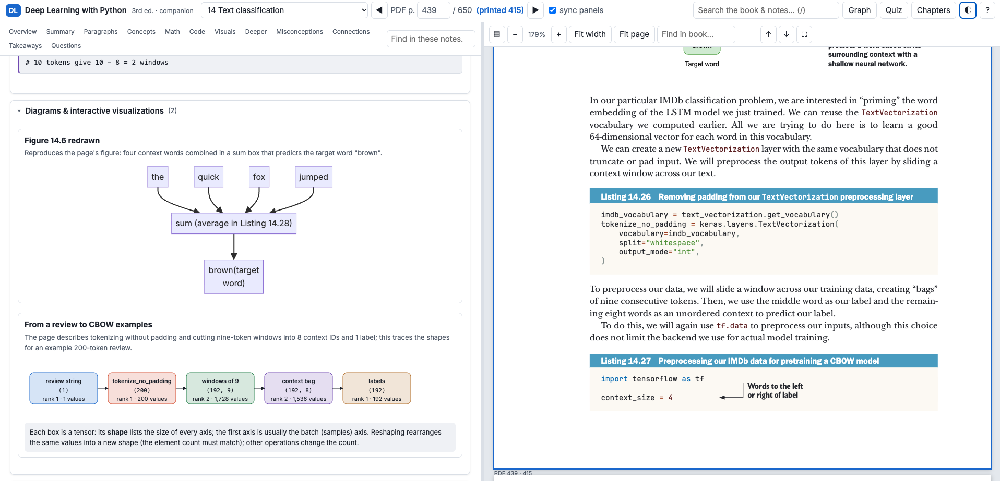
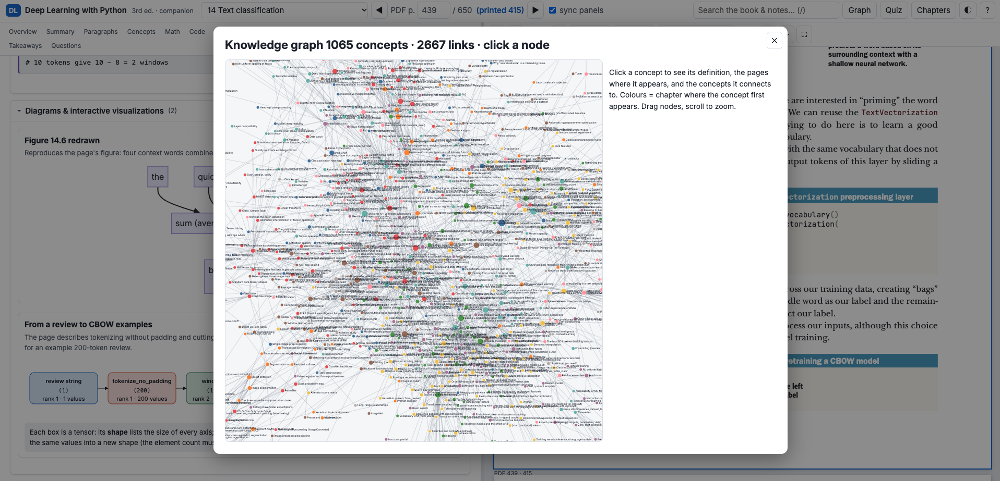

# Deep Learning with Python (3rd ed.) — Offline Interactive Companion

A static, self-contained learning environment: the **original book** on the right (PDF.js), and a
**page-specific educational companion** on the left (overview, detailed summary, paragraph-by-paragraph
notes, concepts, LaTeX math, code walkthroughs, interactive visualizations, misconceptions, cross-page
connections, takeaways, review questions). All content was generated **in advance**; at runtime there is
no AI model, no embedding model, no API, and no internet.

## Screenshots

Book page on the right, its precomputed companion on the left (PDF p.439, CBOW preprocessing in
chapter 14), with the page's diagrams and interactive visualizations:



The knowledge graph of 1,065 concepts and 2,667 links extracted from the whole book:



## Open it

```bash
cd book_companion
python3 serve.py          # opens http://127.0.0.1:8765/  (stdlib only, loopback only)
```

The local server exists because browsers block `fetch()` of local JSON/PDF files from `file://` URLs.
It serves files only; it does no inference and needs no network.

`python3 serve.py 8766` uses another port if 8765 is taken.

### Highlights & personal notes

- **Highlight text** on the book page *or* in the companion notes: select it and pick one of five colours
  from the toolbar that appears; **✎ Note** highlights and opens a note at once.
- **Click a highlight** to write/edit its note (Markdown and `$math$` work), change its colour, or delete it.
- **Pin a note anywhere** on a page — figures, margins, code: press **✎ Note** in the viewer toolbar (or `n`)
  and click the spot. Pins can be dragged; shift-click keeps note mode on for several pins.
- **My notes** (`a`) lists everything by page, with filters (text, colour, book/notes, only-with-note),
  *Go to*, *Edit*, *Delete*, **Export** and **Import** (JSON, merged by id). Your notes also show up in global search.
- Book highlights are stored in page-relative coordinates, so they stay in place at any zoom. Notes-panel
  highlights are anchored by quoted text plus context; if a page's notes are regenerated and the text is
  gone, the app says so and the item stays in *My notes*.
- **Storage:** saved instantly in the browser and, through `serve.py`, in `data/user/annotations.json`
  (atomic writes; the endpoint only accepts same-origin JSON on 127.0.0.1). Commit that file to back up
  your notes with git.

### Review & progress (learn it, then keep it)

- **Spaced-repetition review** (`Review`, key `r`): flashcards built from the book's own generated
  questions and concepts. A page joins your deck after ~45 s of study, when you mark it, or with
  *Add chapter to review*. Rate each card Again / Hard / Good / Easy (keys `1`–`4`, `Space` shows the
  answer); intervals grow for what you know and shrink for what you miss (SM-2 style). New cards per
  day is adjustable (default 20).
- **Page status**: `✓ Understood` / `? Confusing` buttons at the top of every page's notes, with the time
  you spent on the page. Open questions in the notes and quizzes get *I got it / I missed it* buttons so
  every answer counts.
- **Progress** (key `p`): pages studied, study time, accuracy, review streak and mature cards; a map of
  all pages coloured by status; a per-chapter table; your confusing pages and weakest pages.
- **Weak-spots quiz** (in Progress and in Quiz): questions mixed across chapters, weighted toward what you
  got wrong, forgot in review, or marked confusing.
- Saved in the browser and, through `serve.py`, in `data/user/study.json`.

Keys: `←/→` page · `+/-` zoom · `f` full screen · `/` search · `g` knowledge graph · `q` quiz · `t` thumbnails · `n` pin a note · `a` my notes · `r` review · `p` progress.

## Architecture

```
Phase A (preparation, AI allowed)                         Phase B (runtime, no AI)
book/original_book.pdf ─► extract_content.py ─► work/extracted_pages.json      index.html + assets/
                         (font/position-based classification of every line)   ├─ PDF.js viewer (right)
                      ─► build_index.py ─► chunks + BM25 + dense vectors        ├─ notes renderer (left)
                         + SQLite metadata.db + related-page graph             ├─ widgets.js (29 interactive widgets)
                      ─► generate_page_notes.py context ─► work/context/*.md    ├─ MiniSearch full-text search
                         (page elements, image path, neighbours, retrieved      ├─ D3 knowledge graph
                          passages, chapter outline)                           └─ quiz, chapter overviews
                      ─► Claude (subagents / API) ─► data/pages/page_NNN.json
                      ─► validate, render-check, build_application.py ─► data/{search,quizzes,knowledge_graph,…}
```

**Extraction (Stage 3).** The book is a born-digital Manning PDF, so OCR is unnecessary (checked per page).
Lines are classified by font and position: body (New Baskerville 10pt), code (JetBrains Mono), callouts,
section/subsection headings (Franklin Gothic at fixed sizes, incl. small caps), listing/figure/table
captions, figure-internal labels (Arial), sidebars, footnotes, bullets, running heads. Every element keeps
its page, bbox, id (`p061_e03`) and chapter/section/subsection from the PDF outline. Nothing is discarded;
unclassifiable lines would be kept as `other` (currently 0). Both PDF page and printed page label are stored.

**Index (Stage 4), hierarchical + hybrid.** L1 structure (book › chapter › section › subsection › page);
L2 element-aware chunks (never split code, captions stay with content, long paragraphs split at sentences
with 1-sentence overlap; 2 580 chunks); L3 related pages (dense + BM25 fused); L4 retrieval = BM25 + dense
(`BAAI/bge-small-en-v1.5` via ONNX, preparation only) + metadata filters (page / chapter), reciprocal-rank
fusion. Vectors are a numpy matrix: exact search over 2.6k vectors is instantaneous, so FAISS adds nothing.
SQLite (`indexes/metadata.db`) holds pages, elements, chunks (+FTS5), listings, figures, TOC.

**Generation (Stage 5).** Each page gets a context bundle and its rendered image; the generator follows
`scripts/GENERATION_GUIDE.md` and writes one JSON package validated by the Pydantic schema in
`scripts/common.py` plus traceability checks: paragraph notes must reference real element ids and quote
the element's opening words; `original_code` must match the page's extracted code; page references
must exist; MCQ answers must be one of the options; widget names must exist. Every item carries a
provenance tag — `book`, `ai_explanation`, `analogy`, `inference` — shown as coloured badges in the UI.
Uncertain extraction is surfaced as `review_flags` (shown as ⚑ badges), never silently guessed.
Generation is **resumable**: `pending` lists pages without a valid package; existing pages are never redone.

**Visualizations (Stage 6).** Packages declare visuals; nothing is decorative or generic. Types: one of 29
parameterised interactive widgets (gradient descent, backprop graph with forward/backward/update stepping,
convolution/pooling stepper, attention heatmap, NN architecture inspector, vector geometry, softmax
temperature, overfitting, k-fold, …), Mermaid diagrams, Chart.js charts, sanitised inline SVG.
`generate_visualizations.py` renders every declared visual and every KaTeX formula in headless Chrome.

## Pipeline commands (from `book_companion/`, using the project venv `../.venv/bin/python`)

| stage | command |
|---|---|
| 1 inspect | `python scripts/inspect_document.py` |
| 3 extract | `python scripts/extract_content.py` |
| 4 index | `python scripts/build_index.py` |
| 5 bundles | `python scripts/generate_page_notes.py context` |
| 5 pending pages | `python scripts/generate_page_notes.py pending` |
| 5 check pages | `python scripts/generate_page_notes.py check data/pages/page_061.json` |
| 5 unattended (optional) | `ANTHROPIC_API_KEY=… python scripts/generate_page_notes.py api --range 25-100 --workers 4` (needs `pip install anthropic`) |
| 6 render check | `python scripts/generate_visualizations.py` |
| 8 integrate | `python scripts/build_application.py` |
| 9 validate | `python scripts/validate_content.py` → `reports/validation_report.json`, `reports/completion_report.json` |
| 9 browser test | `python scripts/browser_test.py` → `reports/browser_test_report.json`, `reports/screenshots/` |

## Layout

```
index.html  serve.py  README.md
assets/  css/ js/(app.js, widgets/) pdfjs/ math/(KaTeX+fonts) vendor/(marked, DOMPurify, MiniSearch, Chart.js, D3, Mermaid)
book/original_book.pdf          read-only copy of the original
data/pages/page_NNN.json        one educational package per PDF page
data/user/annotations.json      your highlights & notes (created on first save)
data/user/study.json            your review deck, page status and quiz history
data/{book_metadata.json, chapters/, concepts/, diagrams/, quizzes/, knowledge_graph/, search/}
indexes/{metadata.db, keyword_index/bm25.pkl, vector_index/chunks.npy}
scripts/                        the pipeline (above) + GENERATION_GUIDE.md
work/                           extraction output, page images, context bundles (preparation only)
reports/                        inspection, extraction, index, generation, render, validation, completion, browser test
```

## Honest limitations

- Runtime search is lexical (MiniSearch with prefix + fuzzy matching over book text, notes, concepts,
  formulas, code and questions). Semantic retrieval was used during preparation (related pages,
  context retrieval); no model is shipped, so arbitrary queries are not embedded at runtime.
- Page numbers in notes are **PDF page numbers**; the printed number is shown next to them.
- Widgets illustrate the page's ideas with parameters taken from the page; they are teaching models,
  not re-executions of the book's training runs.
- The original PDF is the authority. Where the book itself omits something (e.g. the scaling matrix on
  p.61 printed only inside Figure 2.11), notes say so and flag it.
